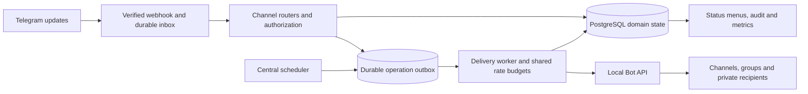

# Channel Manager development plan

Prepared 28 October 2026 against commit `10e9b83`. This is a proposal for implementing the [feature inventory](FEATURE_ANALYSIS.md), not a claim that those features already exist.

Implementation is split into eight [phase documents](phases/README.md). Use those documents as the execution checklists; this document remains the shared architecture and behavior reference. Phases 1–6 are implemented; see the [foundation](PHASE_01_VERIFICATION.md), [publishing](PHASE_02_VERIFICATION.md), [advanced publishing](PHASE_03_VERIFICATION.md), [source automation](PHASE_04_VERIFICATION.md), [membership](PHASE_05_VERIFICATION.md), and [growth/billing](PHASE_06_VERIFICATION.md) verification records. Phase 0 live compatibility work and Phase 7 production readiness remain. The [Phase 6 runbook](GROWTH_AND_BILLING.md) records the selected full-manager sender role, private reveal/media fallbacks, consent and commercial behavior.

## Proposed scope and releases

Create `bots/channelmanager/`, display name **Channel Manager**, table prefix `chm_`, environment prefix `CHANNELMANAGER_`, and callback prefixes `chm:` (channels) and `chp:` (publishing). Start as a standalone bot. Add branded factory operation once the standalone workflows pass their release gates.

Start with `Feature.ADMIN`, `Feature.LANG`, `Feature.BROADCAST`, and `Feature.DAILY_STATS`. Shared broadcasts remain a platform-operator tool; channel campaigns use their own scoped service. Do not enable personal VIP, global forced subscription, or generic group-management menus as substitutes for channel-specific functionality.

| Release | Included outcome | Feature IDs |
|---|---|---|
| R1: publishing MVP | Connect channels, check rights, compose/preview text and basic media, link buttons/signatures, save drafts, publish now/later, edit/delete/detach, multi-channel result reporting, internal audit | CH-01–03, basic CH-11/14, CH-18 foundation |
| R2: publishing automation | Advanced buttons/voting, presets, recurrence, batch composition, calendars, auto-complete, filtered forwarding | CH-04–06/13, advanced CH-02/03/14 |
| R3: membership | Approval-link onboarding, delayed/bulk approval, captcha, required chats, join filters, goodbye/departure actions, external event logs, service cleanup | CH-08/09/11/12/15 |
| R4: commercial and growth completion | Channel-scoped campaigns, locked content, Must Share, virtual admins, branded bots and native menu/feedback integration, channel Stars purchases and plan lifecycle | CH-07/10/16–18, advanced CH-08/13 |

R1 is useful independently. R4 targets the documented product families; exact competitor UI parity and external Modular interoperability remain separate validation items. AI-generated content, web dashboards, full shop functionality, and user-account/MTProto automation are outside this plan.

## Repository findings and reuse

Paths below refer to inspected source, not assumptions from the README alone.

| Existing foundation | Reuse | Required adaptation |
|---|---|---|
| [BotModule](../../core/sdk/module.py), [registry](../../core/sdk/registry.py), [BotContext](../../core/sdk/context.py) | Discovery, fresh routers, service injection, scheduled/process hooks, prefixed models | New module/services/models/locales; expose metrics and operator admin sections |
| [Dispatcher](../../core/runtime/dispatcher.py) | `priority_routers`, `update_pipeline`, `required_update_types` already exist | Route channel events explicitly. The existing `message_pipeline` is attached to messages/edited messages, not channel-post observers |
| [Membership router](../../core/routers/membership.py) | Private block state and group tracking | It ignores channels. Add a narrow priority channel-membership router so a core catch-all cannot consume channel onboarding events |
| [User middleware](../../core/middlewares/user.py) | Identity/language resolution | Channel posts may lack an individual sender. Do not require `BotUser` on channel handlers or treat any observed membership/join event as proof of private-chat interaction |
| [Scheduler](../../core/runtime/scheduler.py) | Replica locking, persisted sweep times, bounded execution | Store business schedules/occurrences in SQL. A periodic sweep lock does not make individual Telegram sends exactly once |
| [Broadcast service](../../core/services/broadcast.py) | Useful campaign/runner patterns, cancellation and rate handling | Current audience is bot-wide `BotUser`, not channel leads. Its checkpointed cursor is not a per-recipient delivery ledger and can repeat a tail after a crash. Add scoped recipients and durable outcomes before owner-facing campaigns |
| [Force subscribe](../../core/services/forcesub.py) | Membership-check and replay concepts | Current requirements are bot-wide, positive checks are cached ten minutes, and default errors fail open. Channel admission/unlocking needs scoped requirements, fresh checks at sensitive boundaries, and fail-closed handling with actionable configuration errors |
| [Payments](../../core/services/payments.py), [VIP router](../../core/routers/vip.py), [CV purchases](../../bots/cvbot/payments.py) | Stars verification, idempotent payment records, atomic `record_one_off_payment(..., grant)` | Personal `vip_until` is not channel entitlement. Add channel grants/invoices/refund reconciliation; register narrow payment handlers before generic VIP handling |
| [Factory](../../core/factory/children.py), [runtime](../../core/factory/runtime.py) | Token encryption, owner checks, child contexts, invalidation/lifecycle | New template or purpose-built sender role; explicit channel-to-sender binding; one update owner per token; no arbitrary raw-token sending path |
| [Gateway](../../core/runtime/gateway.py), [child serving](../../core/factory/serving.py) | Existing webhook infrastructure | Durable acknowledgement is currently selected by a `groupguard` slug check. Generalize this to an SDK capability for modules needing committed ingress before acknowledgement |
| [Child subscriptions](../../core/factory/webhooks.py) | Existing join/member/channel update subscriptions | Fixed list lacks `edited_channel_post`. Update both webhook and child-polling subscription behavior |
| [Group Guard durability](../../bots/groupguard/durable.py), [module](../../bots/groupguard/module.py) | Review inbox, fenced claims, uncertain outcomes, and cleanup design | These helpers import Group Guard-specific models/actions. Do not import them directly as generic channel infrastructure; adapt the pattern or extract a narrowly tested shared primitive |
| [SDK guide](../BOT_SDK.md), [design system](../DESIGN_SYSTEM.md), [tests](../../tests/conftest.py) | HTML UI, escaping, Fluent localization, recording Bot API, migration/integration harness | English and Arabic interfaces, locale parity, channel update builders, new feature/regression tests |

No additional message broker is justified initially. Keep PostgreSQL authoritative, Redis for coordination/caches, and the existing local Bot API for transport. Add a `channelmanager worker` process for bounded delivery work; use the central scheduler to enqueue due work and handle maintenance.

## Telegram compatibility gate

Current documentation must be reconciled with the deployed SDK/server and actual clients. The local Python environment inspected for this review has no installed `aiogram`; the repository records `aiogram==3.31.0` in its verified dependency snapshot. Docker currently permits an unpinned local Bot API image. No live compatibility test was performed.

Verified API facts: join-request `user_chat_id` permits contact for five minutes until processing, subject to administrator-contact conditions; ordinary deletion is limited to messages under 48 hours and excludes creation service messages; `can_edit_messages` covers other users' channel messages and channel pinning; `chat_member` requires explicit subscription. Button styling and custom-emoji fields exist, with emoji eligibility restrictions. Current documentation also describes ephemeral replacement responses and welcome-message permissions. [Telegram Bot API](https://core.telegram.org/bots/api).

Telegram describes ephemeral responses that privately replace a tapped message for one viewer, and notes rich/ephemeral combinations for groups or channels. This makes a personal reveal worth testing; a blanket claim that personal views are impossible would be outdated. [Telegram bot features](https://core.telegram.org/bots/features#ephemeral-messages).

Telegram's FAQ gives approximately 30 bulk messages/second, one message/second per chat, and 20/minute per group as default guidance. Use conservative shared limits and obey actual retry responses. [Bots FAQ](https://core.telegram.org/bots/faq#my-bot-is-hitting-limits-how-do-i-avoid-this).

Digital service purchases inside Telegram use Stars (`XTR`); fulfill after successful payment and retain charge IDs for refunds. [Stars payments](https://core.telegram.org/bots/payments-stars).

Phase 0 must produce a versioned compatibility matrix for: manual-channel edits/keyboards/media, albums, caption placement, cross-chat replies, protected forwarding, styled/emoji buttons, ephemeral channel reveals, welcome reachability, and custom sender media reuse. Pin the tested server image. Where exact behavior is unproven, ship a documented fallback rather than assume support.

## Architecture and module layout

```text
bots/channelmanager/
  __init__.py, module.py, config.py, settings.py
  models.py, schemas.py, authz.py, permissions.py
  handlers/             # channel setup, composer, library, automation, members, billing
  services/             # posts, schedules, rules, routes, joins, leads, entitlements
  rendering/            # entities, media, buttons, previews
  ingress.py            # durable relevant-event inbox and update deduplication
  outbox.py, worker.py   # durable Telegram operations and bounded dispatch
  jobs.py, admin.py, metrics.py
  locales/en/messages.ftl
  locales/ar/messages.ftl
tests/bots/channelmanager/
```

Relevant updates: `message`, `edited_message`, `channel_post`, `edited_channel_post`, `callback_query`, `my_chat_member`, `chat_member`, and `chat_join_request`; add only the extra inline/native-reaction updates actually used. Explicitly distinguish discussion-group automatic forwards from manually routed content.

Check bot rights per enabled operation: posting (`can_post_messages`), editing/channel pinning (`can_edit_messages`), deleting others' messages (`can_delete_messages`), approval/invite management (`can_invite_users`), and bans (`can_restrict_members`). Ask for only the rights needed by selected features and show which feature is disabled when a right is missing. [Telegram administrator rights](https://core.telegram.org/bots/api#chatadministratorrights).

Use priority routers only for narrowly filtered channel lifecycle, deep links, and channel-payment payloads that need precedence. Leave shared support/language/platform administration working. Ordinary channel operators use channel menus; `/admin` remains for platform/bot operators.



This diagram is the proposed architecture. It does not imply that committing SQL and sending to Telegram can form one atomic transaction.

## Proposed data model

Every resource is scoped by `bot_id`; channel-owned resources also carry `channel_id`. Composite foreign keys or equivalent enforced constraints must prevent cross-bot/channel references. Use `BigInt` IDs, `TZDateTime`, and Alembic revisions following the actual migration head at implementation time.

| Tables / domain | Key records and constraints |
|---|---|
| `chm_channels`, `chm_channel_roles` | Channel status, timezone, controller/sender binding, rights snapshot; owner/native/virtual role and individual action permissions |
| `chm_posts`, `chm_post_versions` | Creator, saved/draft status, immutable content versions, structured entities/media/buttons, defaults snapshot; optimistic version check |
| `chm_targets`, `chm_deliveries` | Target chat, post version, occurrence, sender bot, remote message IDs, status/error; unique logical delivery per occurrence/target; fan-out can partially succeed |
| `chm_schedules`, `chm_occurrences` | One-off/recurrence specification, timezone, next due, generation, pause/start/end; unique schedule/generation/time occurrence |
| `chm_batches`, `chm_calendars`, `chm_calendar_slots` | Ordered drafts, weekly slots, assignment reservations, batch progress; prevent duplicate active slot assignment |
| `chm_presets`, `chm_auto_rules`, `chm_forward_routes` | Ownership, ordered conditions, transformations, original/transformed routing, destination capability checks and cycle validation |
| `chm_join_requests`, `chm_challenges` | Request generation, private contact deadline, gate status, timer/manual approval, attempts, expiry, final decision |
| `chm_required_chats`, `chm_invites`, `chm_referrals` | Ordered gate requirements; owned invite attribution; distinct invitee evidence; no self-referrals or repeated credit |
| `chm_leads`, `chm_campaigns`, `chm_campaign_recipients` | Sending bot, channel association, interaction/opt-out evidence, audience snapshot, per-recipient outcome; unique campaign/recipient |
| `chm_locked_posts`, `chm_unlocks`, `chm_votes` | Locked/unlocked version IDs, gate policy, per-user delivery/vote state, vote closure; unique user vote under chosen voting policy |
| `chm_plan_versions`, `chm_invoices`, `chm_entitlements`, `chm_entitlement_grants` | Immutable quote/limits, payer/channel, purchased period/tier, source payment, ledgered grants and refund adjustments |
| `chm_inbox`, `chm_operations`, `chm_events` | Unique bot/update receipt, fenced operation leases, dispatch marker, sanitized error/outcome, internal audit and external-log state |

Use typed payload schemas and bounded JSON for flexible content/rules, not an unvalidated settings blob. A shared post must not give an editor access to channels they do not administer. Media references record the bot that owns the file reference; cross-sender reuse requires a tested transfer path.

## Workflow contracts

### Publishing and scheduling

1. Operator selects an authorized channel, composes content/buttons, and receives a preview using the same renderer as publication.
2. Validate formatting, lengths, supported media, target rights, entitlement limits, and the local-time schedule. Show a final target/time summary.
3. Commit an immutable version and target operations together. Treat each target independently; display successful and failed destinations.
4. A worker claims an operation, revalidates permissions/configuration, dispatches, and records remote IDs and follow-up pin/deletion obligations.
5. Edits and cancellation increment a generation. Stale jobs cannot publish an old version. Editing shared content requires a target-impact preview.

Use incoming Telegram entities and validated HTML first. Add legacy/new Markdown and the guide's custom HTML shorthand through explicit compatibility parsers in advanced publishing; convert shorthand to supported entities or text transformations before transport. Recheck channel quotas transactionally while creating schedules/rules so concurrent operators cannot exceed the same limit.

Proposed calendar rules: store instants in UTC with an explicit IANA channel timezone; prompt for ambiguous local times; skip invalid month days; interpret overnight windows across midnight; combine selected weekday/month-day constraints with AND. On downtime, send one-off posts within a configurable lateness grace period, otherwise hold for review. Skip missed recurring occurrences by default. Reserve batch slots transactionally. Preview the next five recurrence times before activation.

Schedule deletion from the confirmed remote send time. If a requested deletion cannot be automated, show a reminder-only outcome before activation and retain a manual-action record. For recurring replacement, publish the new occurrence before removing the previous one by default, accepting a brief overlap to avoid losing content on send failure; offer strict remove-first only if explicitly chosen in configuration.

### Auto-complete and forwarding

Process source event → deduplicate → load applicable configuration → evaluate filters → transform a canonical copy → persist planned edits/routes → dispatch. Apply at most one auto-complete set by default, selected by explicit priority. Evaluate conditions on original input. Prefix/suffix transformations must be repeat-safe and preserve entity positions, including emoji and right-to-left text.

Mark managed outputs with provenance. A new content version may be processed; the bot's own enrichment must not recursively enrich itself. Reject route cycles at setup and retain runtime hop/provenance protection. Define source-edit propagation as an explicit option, off by default; do not silently propagate deletion. Use album-aware collection and capability-specific rendering. Rebuild or omit destination-specific callbacks according to policy.

Phase 4 implements this with `/automation`, durable source/part/snapshot/action/output records, generation-fenced outbox work, and revision `0022_chm_automation`. Exact implemented contracts and limits are in [source automation](SOURCE_AUTOMATION.md): photo/video album signatures, copy-only edit propagation, future-receipt configuration activation, and conservative handling of unknown outcomes. Attributed forwarding uses the live source; it cannot reproduce an immutable historical snapshot.

### Admission and departure

Persist the join request before work begins. Admission order: active-channel/total-block checks → join-rate/profile filters → contact/captcha workflow → required-chat membership → invitation condition if enabled → timer/manual approval condition → final fresh eligibility check → approval → reachable welcome delivery.

All enabled gates must pass. A delayed-approval timer cannot bypass an unsolved captcha; an invitation timeout bypasses only its own invitation threshold. Manual overrides require a separate explicit action and audit. Repeated updates for a completed request must not reset it. Rejoins use a new request generation; expiry jobs cannot reject a newer request.

Attempt pre-approval contact promptly and offer a signed start link to establish continued interaction. Treat the newer welcome permission as a separate compatibility result, not an assumption of unlimited messaging. Record blocked/unreachable results without endlessly retrying. Bulk approval operates on the observed persisted queue and reports skipped/stale requests.

For departure actions, inspect the full old/new membership transition and actor. Default to no departure ban. If enabled, distinguish voluntary leave from administrative removal and our own enforcement to prevent loops. Store timed unbans as cleanup obligations that survive ordinary plan expiry; pause/delete handling must report any cleanup it cannot complete.

Phase 5 implements the standalone membership subset through `/members` and revision `0023_chm_members`. See [member workflows](MEMBER_WORKFLOWS.md) for exact gates, future-receipt configuration, required private starts, observed-queue bulk limits, native API race boundaries, and cleanup policy. Paid entitlement transitions and invitation conditions remain Phase 6.

### Locked content, campaigns, and delegation

Keep the public locked message unchanged. On unlock, check the current user against the post's required chats. Prefer a tested per-user ephemeral reveal; otherwise use a signed private-chat link, recheck access there, and deliver privately. Never globally edit a public teaser to the secret version.

Campaigns select only channel-associated leads reachable by the chosen sender, with explicit private interaction and applicable opt-out state. Snapshot recipients, preview audience/content, confirm the send, persist each result, and support cancellation. A person associated with channel A must never enter channel B's audience because both use the same bot. Treat competitor minimum-audience and forced-lead rules as configurable product choices.

Virtual-admin permissions are channel-scoped: create, edit own/all, delete own/all, manage schedules, and optionally manage settings. Only the verified owner or authorized native administrator can delegate. Revalidate sensitive actions and queued delegation-dependent work. If its creator loses access, hold pending publication until an authorized operator adopts it. Usernames are display/search hints, not authority.

### Billing and branded bots

Use prepaid channel periods initially. Server-issued invoices bind payer, channel, bot, immutable plan version, price, and expiry. Verify payer/amount/currency/resource authorization at checkout and fulfillment. Use `record_one_off_payment` with an atomic channel-grant callback; do not grant personal VIP as a substitute. Reconcile late successful payments from stored invoice facts. A unique charge produces one grant.

Add payment-source-linked channel refund handling: the generic personal-VIP refund path alone does not reverse custom grants. Expiry/downgrade pauses paid automation, preserves drafts/configuration, and keeps cleanup obligations. Show affected resources before applying a lower tier; never silently delete excess schedules. Start with simple renewals, then add prorated upgrades and scheduled downgrades.

Register a factory template after standalone validation. Resolve every branded sender through `ChildService`/`ChildRegistry`, enforce ownership and channel rights, use child keyspaces, and define child-stop cleanup and `factory_jobs()` sweeps. Keep billing at the platform control bot while child payments remain disabled under the existing factory contract. A token already hosted elsewhere needs an explicit migration; do not overwrite its webhook as an incidental welcome setting. Native menu/feedback composition needs a defined routing contract, not an assumption that one existing template can simultaneously be several templates.

## Reliability and operational rules

- Commit relevant inbound events before webhook acknowledgement. Generalize the existing Group Guard-specific gateway behavior through an SDK capability and cover both standalone/child ingress. Do not acknowledge business work that exists only in an in-memory task.
- Use unique logical operation keys, row claims with `SKIP LOCKED`, owner/generation fencing, bounded attempts, retry deadlines, and dead-letter visibility. Redis is not the only copy of a publication obligation.
- Distinguish definite rejection from uncertain delivery. A timeout after dispatch may have sent successfully; mark it uncertain and require reconciliation/operator review before resending non-idempotent content. Do not claim exactly-once Telegram delivery.
- Share per-sender/per-chat rate budgets across publications, welcomes, forwarding, logs, and campaigns. Reserve capacity for interactive admission and ordinary posts; prevent paid priority from starving lower tiers. Paid Telegram broadcast acceleration stays off unless separately configured.
- Keep content/recipient data only as needed. Store token references rather than tokens in payloads; sanitize exception/log output. Provide removal of saved drafts, personal lead associations, and revoked sender bindings.
- Measure due-job lag, queue age, success/failure/uncertain counts, rights loss, join-gate outcomes, campaign progress, and cleanup backlog. Use bounded metric labels; do not label metrics with user/channel IDs.

Capacity planning should count outgoing operations, not just channels: one post to ten destinations plus pins and later deletions can generate thirty operations. A 10,000-recipient campaign at a proposed 25 sends/second takes at least 400 seconds before retries and competing traffic. Measure actual workload during the canary before increasing concurrency or adding infrastructure.

## Development phases and estimates

Estimates are engineer-days for one developer familiar with this repository, including focused tests and review. They are planning ranges, not measured velocity or delivery commitments. Dependencies are sequential unless a row says otherwise; no parallel staffing is assumed.

| Phase | Scope and dependency | Completion gate | Effort |
|---|---|---|---|
| [P0: compatibility and contracts](phases/PHASE_00_COMPATIBILITY.md) | Validate capabilities and settle behavior; no implementation dependency | Compatibility matrix, fallback decisions, fixtures, and behavior contracts recorded | 3–4 days |
| [P1: platform foundations](phases/PHASE_01_FOUNDATIONS.md) | Module, channel authorization, migrations, durable ingress/outbox, worker; after P0 | Channel lifecycle and durable processing pass isolation/recovery checks | 5–7 days |
| [P2: publishing MVP](phases/PHASE_02_PUBLISHING_MVP.md) | Compose, save, schedule, publish, edit, delete, and report; after P1 | Complete publishing workflow passes, including restart and partial failure | 6–9 days |
| [P3: advanced publishing](phases/PHASE_03_ADVANCED_PUBLISHING.md) | Advanced buttons, voting, presets, recurrence, multipost, calendars; after P2 | Calendar edge cases, shared-post permissions, and voting pass | 6–9 days |
| [P4: source automation](phases/PHASE_04_AUTOMATION.md) | Auto-complete, keyword rules, filtered forwarding; after P3 | Transformations and routing handle duplicates, edits, albums, and cycles | 6–9 days |
| [P5: member workflows](phases/PHASE_05_MEMBERSHIP.md) | Admission gates, welcomes, filters, departures, logs, cleanup; after P4 in the default sequence | No admission bypass; stale requests, unreachable users, and cleanup handled | 8–12 days |
| [P6: collaboration, growth, and billing](phases/PHASE_06_GROWTH_AND_BILLING.md) | Delegation, locked content, campaigns, invitations, channel plans, branded bots; after P3–P5 | Audience/child isolation, private reveals, payments/refunds, and sender lifecycle pass | 8–12 days |
| [P7: production readiness](phases/PHASE_07_PRODUCTION_READINESS.md) | Integration/load/recovery checks, documentation, rollout; after P0–P6 | Release evidence, canary, and rollback gates pass | 3–6 days |

**R1 publishing MVP: 14–20 engineer-days, approximately 3–4 working weeks. Full proposed scope: 45–68 engineer-days, approximately 9–14 working weeks**, excluding unavailable infrastructure/credentials, external Modular integration, and major SDK/client incompatibilities. Use P0 evidence to revise the range before scheduling the full build.

## Verification and release gates

| Area | Required evidence |
|---|---|
| Authorization/isolation | Owner/native/virtual/outsider cases; forged callbacks; revoked rights; stale menus; two channels under one bot and two factory children |
| Content/UI | Entity round-trip, HTML/Markdown validation, emoji offsets, Arabic text, content limits, unsupported media, album behavior, preview/send equivalence, locale key/variable parity |
| Scheduling | UTC/local-time round trips, DST ambiguity, overnight windows, nonexistent month days, duplicate sweeps, cancellation/edit races, downtime rules, deletion reminders |
| Telegram side effects | 429 retry timing, forbidden/removed bot, duplicate events, worker crash before/after dispatch, uncertain status, lost lease, partial fan-out, pin failure after successful send |
| Admission/growth | Repeated/reordered join events, rejoin generations, captcha expiry/attempts, missing membership, delayed/manual gates, invitation fraud/repeated credit, voluntarily left versus kicked |
| Leads/campaigns | No cross-channel recipients, sender-specific interaction proof, opt-out/blocked handling, cancellation, restart without blind replay of uncertain recipients |
| Billing/factory | Wrong payer/channel/currency/amount, duplicate/late success, partial-period refunds, expiry/downgrade, child ownership/token rotation/pause/delete, template locale parity |
| Platform regression | Discovery, core router precedence, existing VIP/refunds/broadcasts, required update lists, ingress ACK timing, central and factory sweeps, graceful shutdown |

Use the recording Bot API and fakeredis for focused tests. Use real PostgreSQL for locking/unique constraints/migrations and disposable Redis for replica/lease behavior. Add scenarios to the webhook runtime harness. Validate visual Telegram behavior with private test channels and test bots; production side effects are not required for automated tests.

Implementation check commands, after installing the project's development dependencies:

```text
python -m core bots
ruff check .
mypy
pytest -q tests/bots/channelmanager tests/test_locales.py
pytest -q
```

Also run migration/integration/runtime suites with disposable service configuration as described in [the SDK guide](../BOT_SDK.md) and [operations guide](../OPERATIONS.md). Those implementation checks were not run for this documentation-only task.

Roll out with module/channel feature flags: internal test channels → small publishing-only canary → automation → admission → billing and branded senders. Add a Compose worker/profile and healthcheck, document `CHANNELMANAGER_TOKEN` and `ENABLED_BOTS`, and provide operator views for uncertain/failed work. On rollback, pause new publications/admission automation, stop claims safely, retain audit/payment records and cleanup obligations, and disable the bot without disrupting other modules. Avoid dropping new tables during operational rollback.

## Decisions to validate during P0

The plan can start with the stated defaults. Before public release, record the actual results for ephemeral reveal support, newer welcome permissions, supported formatting/media combinations, and tested sender transfers. Product decisions still needed are our prices/quotas, broadcast eligibility policy, whether branded bots expose the complete manager or only onboarding/sending, and whether literal external Modular interoperability is required. These choices do not prevent building the R1 foundation.
